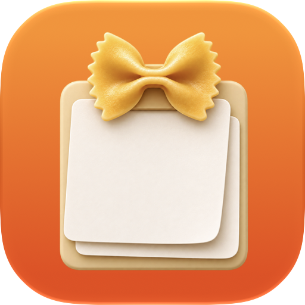

<!--
SPDX-FileCopyrightText: 2026 Matthias Wallner-Géhri
SPDX-License-Identifier: GPL-3.0-or-later
-->

# Pasta

A small native menu bar app for **macOS 27 and later**. Press **⌘⇧V**, or choose your own global shortcut, to open the clipboard history built into macOS Spotlight.



Pasta uses SwiftUI, follows your macOS app language, and includes English and German. English is the fallback language. The keyboard action lives in a separate, testable Swift package.

## Requirements

- An Apple Silicon Mac running macOS 27 or later for the distributed app.
- **⌘Space** configured to open Spotlight, with macOS clipboard history enabled.
- Accessibility permission for Pasta in **System Settings → Privacy & Security → Accessibility**.
- An available global shortcut: other apps may already use ⌘⇧V.

## Install

Download an available ZIP from [GitHub Releases](https://github.com/mpwg/pasta/releases), extract it, move **Pasta.app** to `/Applications`, and start it from there before granting permissions or enabling launch at login. Downloads appear only after a maintainer publishes a prepared release.

**Pasta is ad hoc signed. It has no Developer ID signature and is not notarized by Apple.** macOS may block a downloaded copy. After attempting to open it, use **System Settings → Privacy & Security → Open Anyway**, if offered, and confirm only if you trust this download. See [Apple's instructions](https://support.apple.com/en-us/102445). The published SHA-256 checksums let you check download integrity; they do not replace a Developer ID signature. No paid Apple Developer membership is required to build Pasta.

The app has no automatic updater. Quit Pasta, replace the installed app with a newer download, and reopen it. A changed ad hoc signature can require granting Accessibility permission and registering launch at login again. If permission still appears missing, remove the old Pasta entry from Accessibility, add the installed app again, then quit and reopen Pasta.

### Existing local builds

The public bundle identifier is **eu.mpwg.Pasta**. Older development builds used `local.pasta.Pasta`. This is an identity change: shortcuts, first-run settings, permissions, and login registrations are not migrated automatically. Disable launch at login in the old app and quit it before switching. Configure the new copy and grant its permissions separately.

## Use

On first launch, Pasta opens Settings. Click **Grant Permission …**, enable Pasta in Accessibility, and reopen the app if macOS requests it. Use your shortcut or **Open Clipboard History** in the menu bar menu.

Record a different shortcut in Settings, clear it, or use **Reset** to restore ⌘⇧V. Pasta reserves ⌘Space and ⌘4 for its internal action. **Launch at Login** is off by default and uses macOS Login Items.

## Privacy and behavior

Pasta does not read or store clipboard contents, monitor copies, send telemetry, or make network requests at runtime. Shortcut and first-run preferences are stored locally. macOS owns the clipboard history and its contents; Pasta does not change macOS history retention.

Accessibility access lets Pasta check the focused system application and UI identifiers and send keyboard events. Pasta holds ⌘, presses and releases Space, waits for confirmed Spotlight focus, presses 4, then releases ⌘. It skips Space if Spotlight already has focus. The 4 key is addressed directly to the verified Spotlight process. If focus cannot be confirmed within one second, the action stops. Physical modifier keys must be released; overlapping requests are ignored.

## Build and test

Install **Xcode 27 or later**, launch it once, and finish setup. Command Line Tools alone do not contain the required SwiftUI macro extensions.

1. Open `Pasta.xcodeproj`.
2. Select the shared **Pasta** scheme and **My Mac** destination.
3. Use **⌘R** to build and run, or **⌘U** for core and native UI tests.

The project uses an ad hoc signature with no development team. Xcode resolves the local `Packages/PastaCore` package and KeyboardShortcuts, pinned in the Xcode project and `Package.resolved`. No custom Xcode build phases are required. The `--show-settings` launch argument opens Settings without bypassing permissions or changing preferences.

For the same core checks as CI:

```sh
python3 scripts/check-project.py
xcodebuild -project Pasta.xcodeproj -scheme Pasta -destination 'platform=macOS,arch=arm64' -onlyUsePackageVersionsFromResolvedFile build-for-testing
xcodebuild -project Pasta.xcodeproj -scheme Pasta -destination 'platform=macOS,arch=arm64' -onlyUsePackageVersionsFromResolvedFile -only-testing:PastaTests test-without-building
```

Native UI tests use XCTest; core tests use Swift Testing and send no real keyboard events. See [contributing](CONTRIBUTING.md), [release preparation](docs/releasing.md), and [acceptance evidence](docs/acceptance.md).

CodeQL scans Python scripts and GitHub Actions on pull requests, pushes to `main`, and weekly. Swift analysis is currently blocked by CodeQL's Xcode 27/macOS 27 tracing support; see [CodeQL coverage](docs/codeql.md).

The [October 23 code audit](docs/audit-2026-10-23.md) records source coverage, confirmed findings and current verification limits.

## Known limitations

- Distribution targets Apple Silicon only. Intel support is not verified.
- Download quarantine handling and real launch at login after signing out and back in still need manual acceptance on the public build.
- macOS implementation details may change. Pasta recognizes the classic Spotlight process and the macOS 27 Campo host only when its focused UI is the Spotlight search field.
- The distributed app is not sandboxed; its keyboard automation requires Accessibility access.

The editable icon source is `Pasta/AppIcon.icon`; see [icon documentation](docs/app-icon.md). macOS clipboard history is described in [Apple's guide](https://support.apple.com/en-za/guide/mac-help/mchl40d5b86b/mac).

## Dependency updates

Renovate opens reviewable update PRs for GitHub Actions and Swift dependencies, including Xcode package requirements and resolved commit pins. Actions use readable major-version tags. Updates are not merged automatically. See [dependency maintenance](docs/dependencies.md).

## License

Copyright © 2026 Matthias Wallner-Géhri. Pasta's original code, documentation, and supplied assets are offered under the **GNU General Public License, version 3 or any later version** (`GPL-3.0-or-later`), without warranty. See [license.md](license.md). The icon uses AI-generated artwork; its provenance is documented separately.

KeyboardShortcuts retains its MIT license; see [third-party notices](THIRD_PARTY_NOTICES.md). Release downloads include license notices and the corresponding source archive for the exact build commit.
